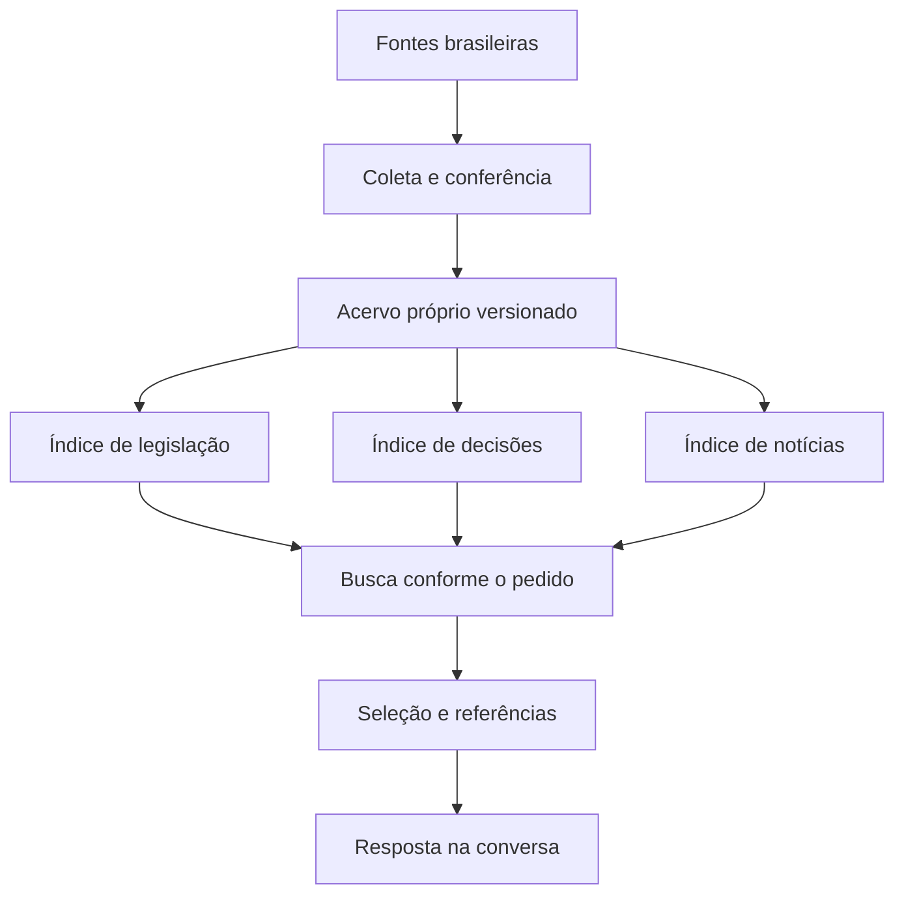

# ROSS AI — Plano do acervo jurídico brasileiro

**Data:** 16/11/2026  
**Escopo:** Brasil; legislação, decisões e atualizações jurídicas.  
**Situação:** implementação parcial, com carga e verificações realizadas. A conclusão operacional está bloqueada pela restrição de gravação do banco; não considerar esta atualização pronta para publicação enquanto a restrição persistir.

## Situação real da implementação — 16/11/2026

| Parte | Resultado verificado |
| --- | --- |
| Catálogo ampliado | 1.218.984 arquivos candidatos, organizados em 12.801 diretórios, gravados no banco. Não são 1.218.984 leis vigentes e únicas. |
| Cópias integrais no banco | 15.252 snapshots preservados; a carga foi pausada por bloqueio de gravação. |
| Acervo preparado e arquivado | 29.614 textos, metadados, catálogo e hashes; ZIP de 129.084.422 bytes. Todos os 15.252 snapshots do banco tiveram SHA-256 conferido contra a cópia do arquivo. |
| Pesquisa além das 66 normas | Referências legislativas preparadas antes da busca; resolução pelo catálogo e leitura da edição fixa com verificação de integridade. A cópia própria é preferida à rede. |
| Novas fontes | Conectores do catálogo oficial do Senado, precedentes qualificados do STJ e manchetes RSS do STJ implementados e consultados com sucesso em testes reais de acesso. Metadados não são usados como artigos; notícias não são tratadas como leis. |
| Interface | Tipos de conteúdo separados na pesquisa, filtros territoriais para legislação, contagem de textos e arquivos distinta e situação do acervo em Fontes. Código preparado; a nova interface não foi publicada no GitHub Pages. |
| Operação administrativa | Importação restrita por autorização temporária, checkpoints sem credenciais e lotes limitados. Não foi criado login nem painel de administrador com autenticação. A tela de situação é somente leitura. |
| Limite atual | Banco com 1.341.099.155 bytes e configuração administrativa de somente leitura; novas migrações estão bloqueadas. Chamadas REST de busca e geração responderam com sucesso nos testes finais. As chamadas pagas à IA continuam bloqueadas quando a cota não pode ser verificada. A tabela de cache persistente das novas fontes ainda não foi criada. |

As consultas amplas anteriores atingiam o limite de oito segundos. A implementação agora resolve primeiro referências específicas, pesquisa metadados antes de varrer artigos e calcula contagens sem descompactar todos os diretórios. Foram executados 188 testes automatizados com sucesso. Em testes reais do backend, a contagem retornou 200, a pesquisa por licitações retornou sete documentos e a LCP 142/2013 retornou três artigos e uma explicação com referências válidas. Notícias e precedentes do STJ retornaram 200. Esses testes não certificam toda resposta jurídica possível.

Foi preservado o backend anterior para retorno de versão. A revisão automática rejeitou uma manutenção que sobrescreveria temporariamente o modo de somente leitura e removeria trechos duplicados do índice, pelo risco de afetar a busca. Essa manutenção não foi aplicada. Uma tentativa de manutenção sem exclusão, por CHECKPOINT, foi recusada por falta de privilégio. Nenhuma tabela de notícias, eventos ou outro aplicativo foi apagada. Não foi contratado plano pago.

O restante deste documento registra a arquitetura e o ponto de partida anterior à carga. As metas ainda não executadas — cobertura integral de estados e municípios, atualização recorrente, novos conectores e administração autenticada — continuam pendentes. Dados carregados não substituem a validação de cobertura e vigência.

## 1. Decisão principal

O ROSS terá uma biblioteca própria, pesquisável por assunto, identificação da norma, artigo, localidade e período. A IA buscará nessa biblioteca os textos necessários para mostrar, resumir e explicar o Direito brasileiro. As fontes externas servirão para completar lacunas, conferir versões e obter atualizações.

As 66 normas atuais serão um conjunto de referência para testes e continuidade do serviço, sem funcionar como limite do novo mecanismo de busca. O catálogo precisa aceitar as normas disponíveis das diferentes esferas. A expansão será medida por fontes e lotes efetivamente processados, sem apresentar uma importação parcial como “todas as leis do Brasil”.

A interface continuará centrada na conversa. Não será necessário conhecer o nome da lei nem escolher uma categoria jurídica antes de perguntar. “Organizar meu caso” continuará uma função opcional; este projeto não a ativa nem reorganiza os fatos das conversas existentes.

## 2. Ponto de partida conferido

| Item | Situação observada |
| --- | --- |
| Base distribuída com o aplicativo | 66 normas, com capturas de fontes oficiais |
| Catálogo do repositório no banco | 235 documentos: 205 federais e 30 estaduais; nenhuma norma municipal nesse catálogo |
| Conteúdo desses 235 registros | Metadados e identificação; zero registros em modo de texto integral no banco. O texto pode ser lido pelo GitHub sob demanda |
| Cópia federal disponível para preparar a ampliação | 29.615 arquivos Markdown; não equivale a 29.615 normas vigentes e únicas |
| Volume desses arquivos | 176.243.408 bytes sem compressão; 58.873.827 bytes comprimidos individualmente com gzip nível 6 |
| Espaço das duas tabelas do catálogo atual | 7.151.616 bytes, incluindo seus índices |
| Tamanho físico total do banco | 1.003.457.683 bytes, aproximadamente 1,00 GB; não corresponde ao tamanho do acervo jurídico nem informa sozinho a franquia ou cobrança do plano |

As medições são de 16/11/2026. A estimativa de aproximadamente 59 MB comprimidos cobre apenas o recorte federal disponível: exclui outras esferas, PDFs, histórico do Git, índices, versões adicionais e cópias de segurança. Esses arquivos ainda não foram importados para o ROSS.

**Limite identificado:** hoje uma lei pode existir no repositório e ficar fora da recuperação porque não está entre os documentos indexados. A busca do acervo também ocorre antes da preparação de termos jurídicos pela IA. A ampliação precisa corrigir a cobertura e essa sequência; aumentar apenas a lista de nomes não basta.

## 3. Fontes e função de cada conteúdo

| Conteúdo | Fontes de partida | Uso no ROSS | Situação da verificação |
| --- | --- | --- | --- |
| Acervo inicial amplo | `ctresb/leis`, em commit fixo | Copiar textos, preservar procedência e construir o índice próprio | Um texto real foi recuperado com HTTP 200; a cópia federal acima foi medida. O repositório reconhece lacunas e problemas de conversão [1] |
| Legislação federal | API de legislação do Senado, Planalto e Legislação Informatizada da Câmara | Identificação, ementas, relações entre normas e conferência do texto na fonte responsável | A API atual do Senado respondeu com JSON válido. O texto da Câmara testado retornou 403 neste ambiente [2–3] |
| Descoberta entre diferentes instituições | LexML | Encontrar referências e links oficiais em várias esferas | Consulta gratuita documentada. O teste automático SRU recebeu uma página de segurança, sem registros válidos [4] |
| Legislação estadual e distrital | Assembleias, Casas Civis e portais oficiais; primeiros adaptadores documentados em MG e SP | Complementar o repositório com metadados e textos da localidade correta | Há documentação oficial de campos, texto atualizado e dados estruturados. Cada adaptador precisa de teste antes da ativação [5–6] |
| Legislação municipal | Câmaras, prefeituras, diários oficiais e instalações SAPL | Pesquisa municipal com identificação explícita do município | O SAPL mantém bases de leis. Não existe, neste plano, uma API única presumida de todos os municípios [7] |
| Atos de órgãos reguladores | Fontes oficiais de CONTRAN, ANVISA, Receita, Banco Central, CONAMA, conselhos e demais órgãos | Portarias, resoluções e instruções pertinentes ao assunto | Cobertura por órgão e categoria; conectores a validar, sem coleta irrestrita de qualquer site |
| Decisões e precedentes | STF, STJ e, depois, demais tribunais | Explicar interpretação e identificar precedentes pertinentes, com situação e alcance próprios | O catálogo CKAN de precedentes qualificados do STJ respondeu HTTP 200 com dados válidos. O STF documenta as diferenças entre teses anunciadas e acórdãos publicados [8–9] |
| Publicações oficiais | DOU/INLABS e diários estaduais e municipais | Detectar publicação, retificação, alteração e revogação a conferir | O INLABS documenta acesso gratuito a PDF/XML e ferramentas de download. Requisitos de conta e acesso devem ser conferidos no conector [10] |
| Notícias e informativos | Canais oficiais dos tribunais, Legislativo e órgãos responsáveis | Contextualizar novidades e encaminhar à norma ou decisão original | O RSS de notícias do STJ respondeu HTTP 200 e XML válido. Informativos serão identificados como resumos, com vínculo ao julgamento [11] |
| Compilações, glossários e livros | Vade Mecum do Senado e materiais com uso permitido | Apoio à leitura e coleções de referência | A edição consultada do Vade Mecum está atualizada até julho de 2026; é uma seleção, não um acervo completo [12] |

Normas, decisões, notícias, proposições legislativas e doutrina terão tipos distintos. Uma notícia não será apresentada como artigo de lei. Um projeto em tramitação não será mostrado como regra em vigor. Uma ementa não será usada como se fosse a íntegra de uma decisão.

Notícias poderão orientar uma nova conferência, mas a explicação de um direito deverá apontar para o texto jurídico pertinente. Na coleta de conteúdo editorial, guardar identificação, endereço, data e resumo próprio; armazenar a íntegra somente quando seu uso estiver autorizado. Acesso gratuito a uma publicação não é, por si só, autorização para redistribuir qualquer obra inteira.

## 4. Arquitetura escolhida

**Armazenamento:** manter os arquivos originais necessários à conferência e os textos normalizados em blocos comprimidos, identificados por hash e versão. Na operação hospedada, usar armazenamento de objetos ou equivalente persistente; não colocar toda a biblioteca no carregamento inicial do site ou no armazenamento do navegador.

**Índice:** aproveitar o Postgres existente para catálogo, filtros e busca textual em português. Os artigos devem ser pesquisáveis pelo conteúdo, preservando parágrafos, incisos, exceções e referências. O dimensionamento deve incluir o texto indexável, os índices e a manutenção de versões — os 59 MB de arquivos comprimidos não são a previsão de custo do banco.

**Processamento:** executar importação, normalização e OCR em um processo próprio de ingestão, separado do atendimento das perguntas. Operações pesadas não devem depender de uma única requisição da função que responde ao chat.

**Busca por significado:** começar com busca textual, termos jurídicos, sinônimos e a preparação de consulta já existente. Acrescentar vetores apenas se uma avaliação demonstrar ganho relevante sobre essa base. A busca híbrida é uma opção técnica documentada, não uma necessidade de gerar embeddings para todo o acervo antes de começar [13].

**Internet:** manter os conectores oficiais como complemento. Uma fonte externa indisponível não deve apagar ou inutilizar as cópias já disponíveis. O catálogo precisa indicar sua cobertura e a data de conferência; a IA não deve preencher lacunas com citações inventadas.

## 5. Contrato de dados e ingresso no acervo

Cada documento deverá registrar:

- Identificador persistente, tipo de conteúdo, título, número, ano e instituição responsável.
- Esfera, estado/DF e município, quando aplicáveis; a mesma numeração pode existir em localidades diferentes.
- Fonte oficial, endereço do texto, provedor usado para obtê-lo e identidade do snapshot do repositório, quando houver.
- Datas distintas de publicação, captura, última conferência e início/fim de vigência, quando conhecidos. Data de captura não comprova vigência.
- Versão, hash dos bytes, relação com edições anteriores e referência para o arquivo preservado.
- Situação conhecida, limitações, qualidade da extração e eventual presença de texto parcial, OCR ou anexos.
- Relações de alteração, revogação, regulamentação e referências a outros documentos, quando sustentadas por fonte identificada.

Cada trecho deverá apontar para a versão exata e para o artigo ou seção efetivamente lidos. A referência permanece associada ao conteúdo mesmo depois de uma atualização.

O ingresso segue esta sequência: obter → conferir identidade e formato → preservar bytes → extrair texto → identificar estrutura → classificar qualidade → indexar o que for utilizável → registrar o resultado do lote.

Documentos incompletos, corrompidos ou sem procedência suficiente ficam identificados para revisão e podem aparecer como registros do catálogo, sem servir automaticamente de fundamento para uma conclusão. Textos históricos e revogados continuam disponíveis para pesquisa histórica, com o período explicitado. Não basta o cabeçalho declarar `revogada: false` para certificar a redação atual.

A importação deve ser retomável, evitar duplicação pelo documento/versão/hash e aproveitar apenas alterações verificadas. Uma tentativa que falhe em um lote não deve tornar os lotes anteriores indisponíveis nem substituir uma versão íntegra por uma conversão parcial.

## 6. Como a pergunta vira uma busca

1. Identificar o pedido, o assunto atual e as informações da conversa que realmente pertencem a ele. Respeitar mudança de tema, estado e período.
2. Preparar termos de pesquisa, sinônimos, referências e filtros. Sugestões da IA são pistas de busca; só se tornam citações depois da leitura de uma fonte correspondente.
3. Pesquisar identificação exata e conteúdo de artigos no acervo próprio. Consultar o índice de decisões ou de notícias quando o pedido exigir esse conteúdo. A busca não depende de uma lista fechada de IDs das 66 normas.
4. Selecionar os trechos pertinentes e suas condições. Quando um artigo depende de outro dispositivo, recuperar o complemento antes de resumir a regra.
5. Se faltar fundamento, fazer uma segunda busca limitada, com termos revistos ou conector oficial disponível. Definir teto de tempo e chamadas para evitar uma cadeia de consultas sem fim.
6. Gerar a resposta a partir dos trechos lidos. Validar se cada referência existe e se sustenta a afirmação. Preservar as limitações de versão, localidade e conteúdo.

Exemplo de teste: “comprei uma TV e apareceram pontos pretos” deve conduzir a artigos pertinentes de legislação de consumo. “Explique mais fácil” mantém o assunto e as referências. Uma pergunta sobre lei complementar que não consta das 66 precisa chegar ao novo acervo por identificação ou assunto.

Se o município ou a data mudar a resposta, perguntar somente essa informação, aproveitando o restante do relato. O sistema não deve inferir que a lei do município de uma conversa vale para outra nem transformar uma hipótese em fato do caso.

## 7. Experiência do cliente

A resposta começa com uma explicação prática e curta. O cliente pode abrir o detalhamento e “Fontes consultadas”, recolhidas por padrão. Ao abrir uma referência, vê o artigo, a origem, a versão e as datas relevantes.

Na pesquisa de documentos, oferecer filtros opcionais por esfera, localidade, período e tipo. A pessoa continua podendo perguntar sem preencher esses filtros. Mostrar uma explicação útil quando não houver resultado ou quando a fonte estiver temporariamente indisponível; esses estados não comprovam inexistência de lei aplicável.

Pedidos para mostrar a lei trazem o texto consultado e o endereço da origem. Pedidos para resumir trazem uma explicação que conserva as condições do trecho. Atualizações jurídicas aparecem como conteúdo complementar identificado; não haverá um mural de notícias obrigatório na conversa.

A preferência futura de comunicação para profissionais do Direito muda a linguagem e o aprofundamento. A base, a rastreabilidade e os critérios de referência serão os mesmos para todos. O planejamento não implementa contas nesta etapa.

## 8. Atualização e qualidade contínua

As seguintes frequências são uma proposta para os trabalhos internos do aplicativo, ainda não agendados:

| Conteúdo | Proposta inicial | Tratamento |
| --- | --- | --- |
| Publicações e atos recentes | Conferência diária nas fontes habilitadas | Identificar novos documentos e alterações; verificar publicação e datas antes de atualizar respostas |
| Coleções próprias e repositório | Sincronização incremental diária quando houver mudanças | Commit fixo, hashes e lotes retomáveis; nenhuma atualização silenciosa de uma citação histórica |
| Precedentes qualificados | Conferência diária de dados disponíveis | Registrar situação, tese, julgamento e publicação; conservar a distinção entre anúncio e acórdão |
| Notícias e informativos | Coleta periódica limitada por feed | Deduplicar; vincular à fonte jurídica original quando possível |
| Cobertura e integridade | Auditoria semanal do processo | Contar falhas, lacunas e atrasos; comparar lotes e amostras de textos |

O painel interno deverá mostrar: documentos descobertos, obtidos, normalizados, indexados, aptos à recuperação e pendentes, por fonte e esfera. Exibir também última sincronização bem-sucedida, erros, bytes e duração. Não anunciar uma porcentagem de “todo o Direito brasileiro” sem conhecer o universo correspondente.

Conectores usarão domínios permitidos, limites de tamanho, tempo e frequência. Página de bloqueio, CAPTCHA ou HTML no lugar de XML/JSON não conta como documento jurídico. Essas falhas são registradas, sem contornar os controles da origem. Textos externos e anexos são dados para leitura, não instruções que podem alterar o comportamento do sistema.

O acervo público fica separado dos arquivos privados dos clientes. Perguntas e provas não entram em repositórios públicos, coleções de treinamento ou índices compartilhados de legislação. A mudança do acervo não abre acesso direto de escrita pelo navegador às tabelas do servidor.

## 9. Etapas e entregas

| Etapa | Entrega concreta | Critério para avançar |
| --- | --- | --- |
| 0 — Capacidade e contratos | Mapa de fontes, capacidade do banco/armazenamento, contrato de documento/versão e conjunto de avaliação | Identificar o uso do banco atual, cotas e custos; fechar o formato antes da carga grande |
| 1 — Biblioteca própria federal | Importação do recorte disponível, arquivo comprimido e índice por artigo, com relatório de aceitos e pendentes | Recuperar documentos além das 66, preservar versões e provar a leitura sem baixar o texto da internet a cada pergunta |
| 2 — Busca integrada à conversa | Preparação de consulta antes da recuperação, seleção de artigos, referências e compatibilidade da tela | Casos de linguagem comum, continuidade e leis fora da base inicial aprovados na avaliação |
| 3 — Estados, DF e municípios | Catálogo nacional e ingresso dos lotes disponíveis; conectores oficiais conforme validação | Localidade correta, relatório por fonte e texto recuperável; município identificado quando necessário |
| 4 — Decisões e atualizações | Precedentes qualificados, decisões selecionadas, feeds e publicações oficiais | Tipos separados; notícia vinculada à fonte; situação da decisão e datas preservadas |
| 5 — Ampliação de volume | Demais lotes e órgãos, melhoria de busca por significado quando comprovada | Qualidade, custo e tempo de recuperação medidos no volume real |

As etapas organizam a execução e não restringem permanentemente o catálogo a um grupo de leis. O objetivo continua sendo a maior cobertura brasileira possível, com lacunas declaradas. A pesquisa de processos e a função opcional de caso permanecem fluxos separados dessa importação.

## 10. Backlog técnico pronto para execução

| ID | Trabalho | Arquivos ou área atual | Aceite |
| --- | --- | --- | --- |
| ACV-01 | Medir capacidade, composição do uso e volume de um lote piloto | Banco e destino dos arquivos | Relatório de bytes, limites e custo; sem exclusão de dados ou contratação automática |
| ACV-02 | Evoluir o importador para lotes com relatório de cobertura e qualidade | `scripts/import-corpus.mjs`, `scripts/lib/law-corpus.mjs` | Retomada, deduplicação, identidade da fonte e falhas registradas |
| ACV-03 | Preservar textos/versionamento em armazenamento persistente | Arquivos do acervo e manifesto | Restauração da versão exata de uma referência |
| ACV-04 | Evoluir o índice de identificação e artigos | `supabase/schema/law-search.sql` e migração revisada | Pesquisa em corpo de artigo, esfera e período, sem depender do catálogo de 66 IDs |
| ACV-05 | Preparar a pergunta antes da consulta ao acervo ampliado | `app.js`, operações `prepare` e `search` | Termos jurídicos e contexto usados na primeira recuperação |
| ACV-06 | Ler do acervo próprio antes do GitHub | `corpusOperation`, `repository_read` e módulo de leitura | Cópia própria responde com a fonte externa indisponível; integridade verificada |
| ACV-07 | Acrescentar o conector federal atual do Senado | Backend e coletor | Contratos testados para `/legislacao/lista` e detalhes; metadados não são apresentados como artigos |
| ACV-08 | Acrescentar fontes estaduais/municipais e LexML | Conectores por instituição | Falha isolada por fonte; localidade e formato validados; sem contornar bloqueios |
| ACV-09 | Evoluir procedência e indicadores de cobertura | `app.js`, `i18n.js`, `corpus_stats` | Fonte oficial e repositório renderizados sem campos obrigatórios específicos de um único provedor |
| ACV-10 | Acrescentar tipos para decisões e notícias | Coleta e índices próprios desses conteúdos | Lei, tese, decisão, informativo e notícia permanecem distinguíveis |
| ACV-11 | Criar sincronização incremental e monitoramento | Processo de ingestão | Atualização observável, idempotente e com recuperação de falha |
| ACV-12 | Avaliar e liberar a nova recuperação gradualmente | Testes de busca e interação | Critérios abaixo atendidos; possibilidade de voltar ao mecanismo anterior |

As operações atuais de leitura precisam manter compatibilidade durante a migração. Uma alteração de esquema será preparada e validada com controle de acesso; este documento não cria tabelas, funções, permissões ou novos endpoints públicos.

## 11. Como comprovar que melhorou

Preparar um conjunto inicial de pelo menos 100 consultas revisadas, cobrindo diferentes áreas, localidades, formatos e datas. Cada consulta deve ter fontes esperadas ou um resultado de esclarecimento definido. Os seguintes números são metas de validação propostas, não resultados já alcançados:

| Avaliação | Critério proposto |
| --- | --- |
| Identificação explícita | Recuperar 100% dos documentos de referência aceitos e presentes no lote de teste, inclusive fora das 66 normas |
| Pergunta em linguagem comum | Em pelo menos 95% dos casos avaliados com fonte esperada, incluir um trecho pertinente entre os 20 primeiros candidatos |
| Referências | Zero referência inexistente na amostra; toda afirmação jurídica testada rastreável ao trecho lido |
| Localidade e tipo | Zero mistura entre municípios, esferas, notícia e norma nos casos de teste definidos |
| Temporalidade | Casos históricos e atuais não trocam suas versões; vigência desconhecida permanece identificada |
| Fonte externa indisponível | Textos próprios continuam pesquisáveis e legíveis; limites externos aparecem corretamente |
| Continuidade | Reformulação, resposta curta e correção aproveitam o contexto pertinente; mudança de assunto não herda fontes inadequadas |
| Tempo da busca | Medir separado do tempo da IA; meta inicial de p95 abaixo de 3 segundos no lote piloto para recuperação sem fonte externa |
| Custo | Medir bytes por documento/artigo, chamadas ao modelo e custo por consulta; não liberar expansão com consumo desconhecido |

Incluir regressões para colisão traseira, produto com defeito, trabalho, família, locação, previdência, tributário, proteção de dados, legislação local e referências desconhecidas. Revisar os resultados jurídicos da amostra antes de uso profissional amplo. Testes de software verificam o mecanismo; não certificam todas as respostas possíveis.

## 12. Custos e limites de implantação

O plano prioriza fontes públicas e abertas. O LexML prevê consulta gratuita; o Senado e as coleções oficiais oferecem dados abertos, e o repositório permite aproveitar textos e procedência. Isso não torna toda a operação de IA e hospedagem gratuita.

O orçamento deverá separar: arquivos comprimidos e versões, índice e banco, transferência de dados, processo de importação/OCR, uso do modelo e eventual busca semântica. Medir um lote real, calcular custo por documento e por consulta e então estimar a ampliação.

Não usar os 59 MB medidos como custo final do acervo nacional. Não presumir espaço livre apenas porque as tabelas jurídicas atuais são pequenas. Não contratar provedor pago ou aumentar um plano durante o planejamento.

**Primeira entrega de implementação recomendada:** biblioteca federal própria com índice de artigos e recuperação demonstrada de documentos além das 66 normas, acompanhada de indicadores reais de cobertura. As demais esferas entram pelo mesmo contrato, sem uma lista fechada de leis admitidas.

## Referências consultadas

1. [ctresb/leis — acervo e procedência](https://github.com/ctresb/leis) e [relatório de cobertura e pendências](https://github.com/ctresb/leis/blob/main/PROGRESSO.md).
2. [Senado — serviços de legislação](https://www12.senado.leg.br/dados-abertos/legislativo/legislacao) e [documentação atual da API](https://legis.senado.leg.br/dadosabertos/api-docs/swagger-ui/index.html).
3. [Portal da Legislação — acesso e reprodução](https://www4.planalto.gov.br/legislacao/servicos/pesquisa-de-legislacao).
4. [LexML — finalidade e busca](https://projeto.lexml.gov.br/documentacao/faq), [API descrita pelo Senado](https://www12.senado.leg.br/dados-abertos/legislativo/legislacao/acervo-do-portal-lexml) e [princípio de gratuidade](https://projeto.lexml.gov.br/documentacao/Apresentacao.pdf/at_download/file).
5. [ALMG — estrutura dos dados da legislação mineira](https://dadosabertos.almg.gov.br/documentacao/arquivos/legislacao-mineira) e [critérios de atualização](https://www.almg.gov.br/atividade-parlamentar/leis/legislacao-mineira/).
6. [ALESP — catálogo de normas e recursos](https://ckan.al.sp.gov.br/group/legislacao/dataset/normas).
7. [Interlegis — Sistema de Apoio ao Processo Legislativo](https://www12.senado.leg.br/interlegis/produtos/sapl).
8. [STJ — dados abertos e acesso automatizado](https://dadosabertos.web.stj.jus.br/) e [precedentes qualificados](https://dadosabertos.web.stj.jus.br/dataset/precedentes-qualificados).
9. [STF — teses de repercussão geral e situação da publicação](https://portal.stf.jus.br/repercussaogeral/teses.asp) e [diferença entre espelho e inteiro teor](https://portal.stf.jus.br/textos/verTexto.asp?pagina=Dicas_de_pesquisa&servico=jurisprudenciaPesquisaGeralNovoPortal).
10. [Imprensa Nacional — INLABS e download de edições](https://github.com/Imprensa-Nacional/inlabs).
11. [STJ — feeds de notícias e informativos](https://www.stj.jus.br/sites/portalp/Paginas/RSS.aspx).
12. [Vade Mecum do Senado — quarta edição, julho de 2026](https://www2.senado.leg.br/bdsf/handle/id/961972).
13. [Supabase — busca híbrida por palavras e significado](https://supabase.com/docs/guides/ai/hybrid-search).

O documento `docs/acervo-brasil-fontes.md` contém os testes anteriores de acesso e as medições que fundamentam o recorte inicial. Referências documentadas ainda precisam de conector e validação operacional antes de aparecerem como integradas no aplicativo.
